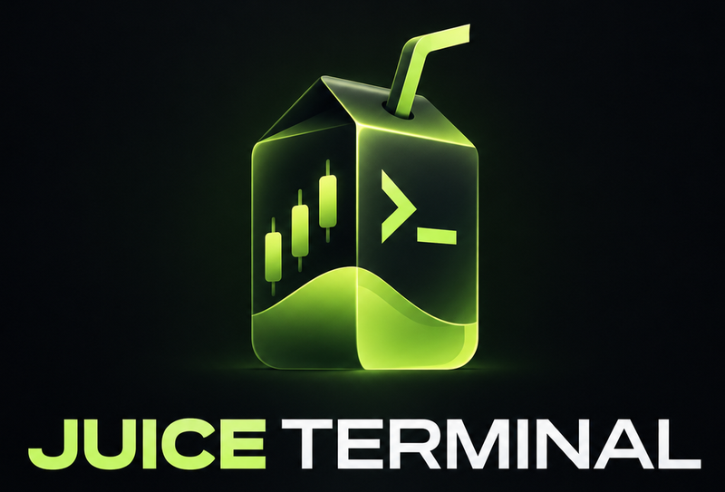
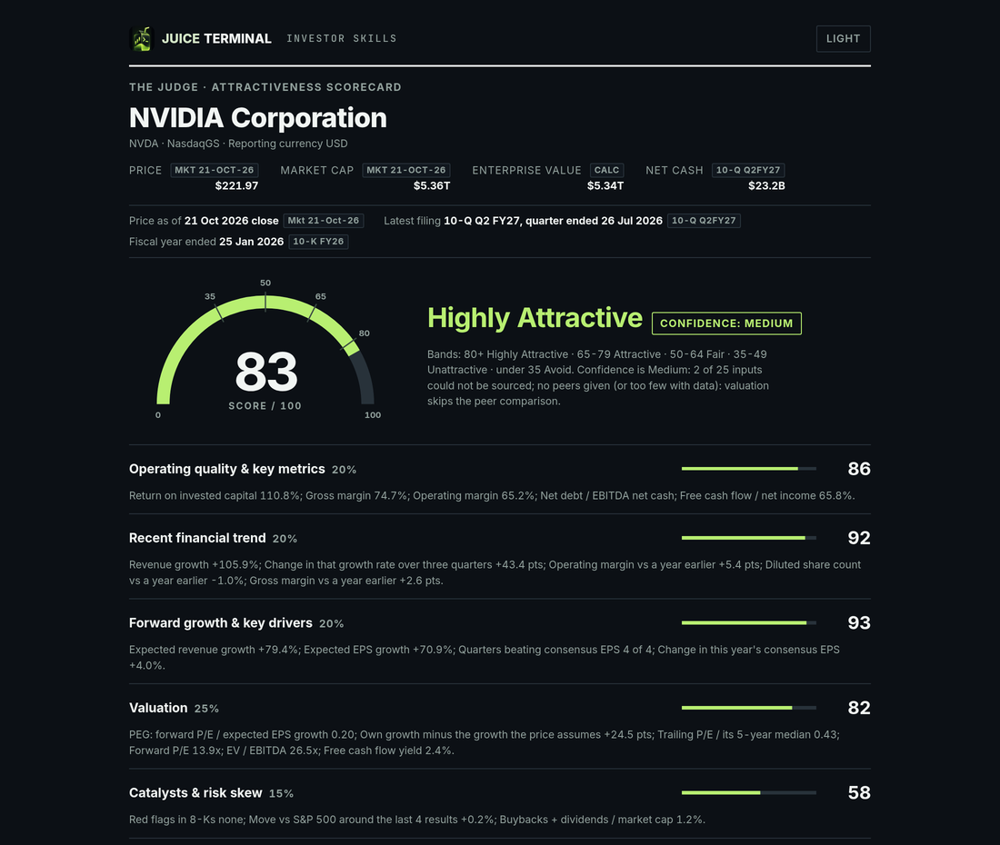
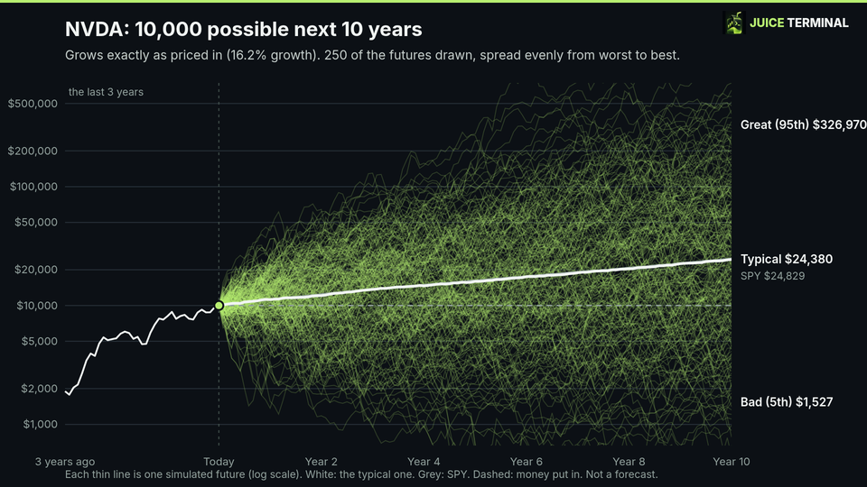
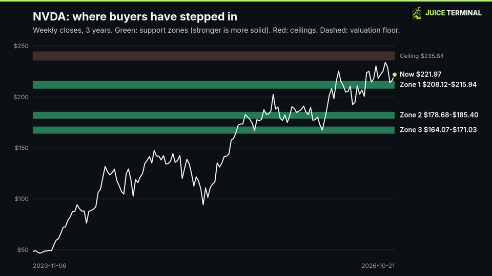

<p align="center"></p>

<h1 align="center">Investor Skills: Free Edition</h1>
<p align="center"><b>The Judge: a sourced 0-100 scorecard for any US stock, as a Claude skill.</b><br>
Plain Python, no API keys, every number traced to an SEC filing or market data.</p>

> Educational use only, not financial advice. Read the [disclaimer](#disclaimer).

<p align="center"></p>

## What you get, free
**The Judge** asks: *how attractive is this company, all things weighed?* It scores a stock 0-100 on five
weighted pillars, with every input's rule and source printed:

| pillar | weight | what it checks |
|---|---|---|
| Operating quality | 20% | return on capital, margins, cash conversion, balance sheet |
| Recent trend | 20% | the latest quarters against a year earlier |
| Forward growth | 20% | consensus, the company's own guidance and how often it beat it, estimate revisions |
| Valuation | 25% | absolute, against peers, against its own 10-year P/E |
| Catalysts & risk | 15% | moves on results, buybacks, customer concentration, red flags in 8-Ks |

Claude adds the thesis, drivers and risks from the filings, clearly marked as Claude's. You get a two-page
report (light and dark), a chart for video and a saved result in `investor/`.

Prefer the browser? The [Juice Terminal web app](https://juice-terminal.onrender.com) shows The Judge free
for any stock.

## Free vs. the full bundle

| | **Free Edition** (this repo) | **Juice Terminal Investor Skills** ([get it](https://juiceterminal.gumroad.com/l/juice-terminal-investor-skills)) |
|---|:---:|:---:|
| **The Judge**: 0-100 scorecard, every input sourced | ✅ | ✅ |
| **investor-setup**: guided one-time setup | ✅ | ✅ |
| **The Scout**: scan ~1,800 US companies through 5 lenses, with 8-K newsflow and red flags | | ✅ |
| **The Mind Reader**: the growth today's price already assumes (reverse DCF + base rates) | | ✅ |
| **The Sniper**: rule-based support zones, their track record and the odds of reaching them | | ✅ |
| **The Time Traveller**: 10,000 simulated decades, paired with the S&P 500 | | ✅ |
| Results flow between bots (Scout → Judge → Mind Reader → Sniper → Time Traveller) | | ✅ |
| One-command installer with success check (Claude Code **and** Cursor) | | ✅ |
| Offline demo: four real NVIDIA reports in seconds, no setup | | ✅ |
| Illustrated PDF guide, Start Here, Quickstart cheat sheet | | ✅ |
| Sample reports and charts | | ✅ |
| Updates and email support | community | ✅ v1.x included |
| Price | free | **US$29** one-time |

<p align="center">


</p>
<p align="center"><sub>In the full bundle: The Time Traveller and The Sniper (sample outputs for NVIDIA, replayed from recorded data, 22 Oct 2026).</sub></p>

## Quick start

You need **Claude Code** (the Code tab in the Claude desktop app, or Claude Code in a terminal) and
Python 3.8 or newer.

1. **Install.** In Claude Code:
   ```
   /plugin marketplace add BremerLim/juice-terminal-skills
   /plugin install juice-terminal-skills@juice-terminal-skills
   ```
   Or paste this page's link into Claude Code and say *"install these skills"*.
2. **Set up.** Say *"set up investor skills"*. Claude checks Python and the data sources and asks once for
   your name and email, because the SEC requires every program that reads its filings to identify itself
   (it is sent only to sec.gov).
3. **Ask.** *"Score Costco"*, *"Give me a scorecard on Nvidia"*, *"Score AMD against Nvidia, Broadcom and
   Intel"*.

Installed as a plugin, the command carries a prefix (`/juice-terminal-skills:the-judge`). Plain English works
either way.

**Cursor:** Cursor loads skills from `~/.claude/skills/`, so copy both folders in `skills/` there; Claude
Code's `${CLAUDE_SKILL_DIR}` placeholder is not filled in by Cursor, so tell the agent the folder path if it
asks. (The full bundle's installer handles this for you.)

## For Claude: installing from this page

1. Prefer the plugin: `/plugin marketplace add BremerLim/juice-terminal-skills`, then
   `/plugin install juice-terminal-skills@juice-terminal-skills`. If you can't run those, ask the user to paste them.
2. Otherwise copy each folder in `skills/` into `~/.claude/skills/`.
3. Then start the `investor-setup` skill.

## If something goes wrong

- **"Python was not found", or Windows opens the Microsoft Store:** say *"set up investor skills"* and
  Claude explains how to install it. On Windows, tick "Add python.exe to PATH", then restart Claude.
- **"SEC EDGAR needs a name and contact email":** run the setup, or tell Claude your name and email.
- **"Not reachable" or network errors:** a firewall, VPN or work network may block sec.gov or yahoo.com.
- **Where is the report?** In `investor/reports/`. Open the `.html` file in any browser.

## The method

**The Judge (Scorecard).**
- **Every input is a rule:** it scores 0-100 on a straight line between two
  printed values (free cash flow yield: 0 at 1%, 100 at 7%). A pillar is the
  average of its inputs; the composite weights quality, trend and forward
  growth 20% each, valuation 25% and catalysts and risk 15%. Missing inputs
  are left out and lower the confidence level, never guessed.
- **Guidance is read from the filings:** the revenue outlook in each results
  press release (8-K, exhibit 99), checked against what the company then
  reported, gives the "beat its own guidance" record.
- **Its own history, done properly:** trailing P/E for every month of 10
  years uses only the earnings known that month, split-adjusted, with the
  fourth quarter derived from figures on the same share basis.
- **Peers are Claude's choice** (business model and end market, stated in the
  report) and compared on Yahoo's figures for every company, like with like.
- **Claude's part is marked:** the thesis, drivers, risks and what would change
  the view carry a "Claude" tag; every computed number carries its source.
- The customer test reads the annual report's own sentences and shows them.
  It handles negations, groups ("ten largest customers"), distributors,
  receivables-only mentions and "respectively" lists.

**Known limits.** Free data can lag or be wrong; the tools warn when financials are over 13 months old.
The thresholds are judgment calls (each is printed), consensus and peer figures are Yahoo's estimates, and
banks, insurers and very young companies fit the rules poorly.

## Disclaimer

This content is for educational purposes only and should not be considered
financial advice. Nothing here is a recommendation to buy or sell any
security. I am not a licensed financial advisor. All investing carries risk
including total loss of capital, and past performance does not predict future
results. AI tools can make mistakes. To the fullest extent permitted by law I
accept no liability for any loss arising from your use of this content. Your
decisions are your own. Speak to a licensed professional before investing.

## Terms of use

© 2026 Juice Terminal. All rights reserved. You may install and use these
skills for your own research. Please don't redistribute, resell or publish
modified versions.

## Tests

```bash
python -m unittest discover -s tests
```

39 offline tests: valuation math, filing parsers (multi-class shares, stale tags, customer sentences from
real filings), the scorecard's rules, and end-to-end runs on responses recorded on 2026-10-22 in
`tests/fixtures/live/`.

## Layout

```
core/investkit.py        shared core (data, filings, valuation math, charts)
tools/sync_core.py       copies the core into every skill folder (run after editing it)
skills/the-judge/        The Judge: SKILL.md (what Claude reads) and scorecard.py
skills/investor-setup/   setup and first steps
hooks/                   the welcome shown after a plugin install, until setup is done
tests/                   unittest suite and recorded fixtures
```
